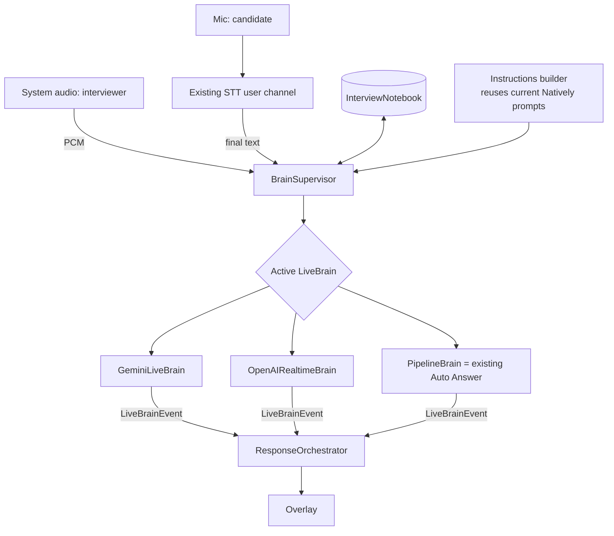

# Live Brain — Architecture Specification

> **Status:** Approved design. Canonical. Branch: `feat/live-brain`.
> **Audience:** every agent (Claude, Codex) and human working on this feature.
> **Rule:** if code and this document disagree, stop and update the document first (with the user's agreement). Do not silently diverge.
> Companion documents: [IMPLEMENTATION_PLAN.md](IMPLEMENTATION_PLAN.md) (what to build, in order) · [PROGRESS.md](PROGRESS.md) (what is done).
> Background research (not normative): `docs/live-conversation-research.md`.

---

## 1. Product goal

Natively should behave like **ChatGPT Voice in a live interview, except it writes instead of speaking.**

It listens to the interviewer continuously, understands like a strong conversational model, waits until a question is really finished, asks one short clarifying question when something important is missing, remembers the whole interview, and **replaces its answer immediately when the interviewer corrects or interrupts**. The candidate (the user) reads the text and says it aloud.

### Decisions already made by the user (do not re-open without asking)

| # | Decision |
|---|---|
| D1 | Personal use, not commercial. |
| D2 | Main realtime brain: **Google Gemini Live (free tier)**. Paid APIs are acceptable. |
| D3 | Answers follow the **current Natively instructions and response style** — reuse existing prompts/contracts; do not invent a new answer style. |
| D4 | **Clarifying questions are required** (one short question, only when it materially changes the answer). |
| D5 | Privacy is not a concern for this user (audio may be sent to Google/OpenAI). Still show a one-line notice in settings. |
| D6 | **Natively never plays or produces audio.** Text is the only assistant output. |
| D7 | Backup: OpenAI Realtime (optional, paid key) → today's Natively pipeline (always available). |
| D8 | Keep it simple. Reuse existing infrastructure. No new services, servers, databases, WebRTC, or native modules. |
| D9 | Everything is behind one setting, **off by default**. With it off, Natively behaves exactly as before. |

### Non-goals

- Text-to-speech, audio playback, voice output of any kind.
- Replacing audio capture, STT providers, or the existing Auto Answer engine.
- GPT-Live (text-only output is not documented by OpenAI — revisit only if that changes).
- Self-hosted audio models, Pipecat/LiveKit, Smart Turn, WebRTC.
- Redesigning the overlay UI beyond the small additions in §7.

---

## 2. Big picture

```
 Interviewer audio (system/speakers)            Candidate audio (mic)
          │   existing native capture — UNCHANGED (macOS SCK/CoreAudio, Windows WASAPI)
          ▼                                              ▼
 ┌──────────────────────────┐                  existing STT (mic channel)
 │ LiveBrain (selected)     │◄── "Candidate said: …" (text item)
 │  • GeminiLiveBrain       │
 │  • OpenAIRealtimeBrain   │◄── Instructions = current Natively answer prompt
 │  • PipelineBrain         │      + clarification rule + profile/resume/JD/mode
 └────────────┬─────────────┘◄──► InterviewNotebook (full-context memory)
              │ LiveBrainEvent stream
              ▼
      ResponseOrchestrator ──► existing overlay delivery (what-to-answer:*, token batches)
              │                    answer · 💬 ask · outdated/replaced · status
              ▼
      BrainSupervisor: health, ~14-min session rollover, fallback chain
```



---

## 3. Components

All new code lives in **`premium/electron/liveBrain/`** (main process, shared across macOS and Windows). No platform-specific code is introduced.

| Component | File | New / Reuse | Responsibility |
|---|---|---|---|
| Types & contracts | `types.ts` | New | `LiveBrain` interface, `LiveBrainEvent`, `NotebookSnapshot`, config types |
| Instructions builder | `instructions.ts` | New (thin) | Builds the session instruction text **from existing Natively prompts** (§5) |
| Response parser | `responseParser.ts` | New | Turns streamed text into `wait` / `ask` / `answer` (§6) |
| InterviewNotebook | `InterviewNotebook.ts` | New | Durable interview memory + summary; seeds new sessions (§8) |
| GeminiLiveBrain | `brains/GeminiLiveBrain.ts` | New | Gemini Live WebSocket session (§4.1) |
| OpenAIRealtimeBrain | `brains/OpenAIRealtimeBrain.ts` | New, reuses socket/backoff/quota/resample logic from `electron/audio/OpenAIStreamingSTT.ts` | OpenAI Realtime text-only session (§4.2) |
| PipelineBrain | `brains/PipelineBrain.ts` | New adapter over existing code | Wraps today's Auto Answer → `IntelligenceEngine` path as a `LiveBrain` (§4.3) |
| ResponseOrchestrator | `ResponseOrchestrator.ts` | New | Owns what the overlay shows; replace-in-place; stale marking; generation ids (§7) |
| BrainSupervisor | `BrainSupervisor.ts` | New | Picks brain, health checks, rollover, fallback chain (§9) |
| Factory | `index.ts` | New | Exhaustive provider switch; wiring into `main.ts` |
| Audio capture | `native-module/*`, `electron/audio/*Capture.ts` | **Reuse, unchanged** | |
| STT (mic; interviewer for PipelineBrain) | `electron/audio/*STT.ts`, `createSTTProvider` in `electron/main.ts` | **Reuse, unchanged** | |
| Auto Answer engine | `premium/electron/autoAnswer/SimpleAutoAnswer.ts` | Reuse (+ Phase 1 correction fix) | |
| Answer prompts | `electron/llm/prompts.ts`, `electron/llm/WhatToAnswerLLM.ts` | **Reuse** | Source of the response style |
| Summarizer | `electron/llm/ConversationSummarizer.ts` | Reuse | Notebook summaries |
| Overlay | `src/components/NativelyInterface.tsx` + `src/lib/overlay*.mjs` | Reuse + small additions | |

### Factory rule (from CLAUDE.md)

Provider selection uses an exhaustive switch. An unknown provider throws; it is never silently routed to another provider.

```ts
switch (config.brain) {
  case 'gemini-live':     return new GeminiLiveBrain(deps);
  case 'openai-realtime': return new OpenAIRealtimeBrain(deps);
  case 'pipeline':        return new PipelineBrain(deps);
  default: { const never: never = config.brain; throw new Error(`Unsupported live brain: ${never}`); }
}
```

---

## 4. The LiveBrain contract

```ts
// premium/electron/liveBrain/types.ts  (normative shape; names may be refined in Phase 2,
// but any change must be reflected here)

export type LiveBrainId = 'gemini-live' | 'openai-realtime' | 'pipeline';

export interface LiveBrainStartContext {
  sessionId: string;              // one per meeting; reset on new meeting
  instructions: string;           // from instructions.ts (§5)
  notebook: NotebookSnapshot;     // empty at meeting start; filled on rollover/fallback
  recentTurns: ConversationTurn[];// last ~3–5 min verbatim, for rollover/fallback seeding
  signal: AbortSignal;
}

export interface ConversationTurn {
  role: 'interviewer' | 'candidate' | 'assistant';
  text: string;
  at: number;                     // epoch ms
}

export type LiveBrainEvent =
  | { type: 'status'; status: 'connecting' | 'ready' | 'degraded' | 'closed'; detail?: string }
  | { type: 'interviewer_speech_started'; at: number }       // interruption signal
  | { type: 'interviewer_speech_stopped'; at: number }
  | { type: 'interviewer_transcript'; text: string; final: boolean; at: number } // display only
  | { type: 'response_started'; responseId: string; at: number }
  | { type: 'response_delta'; responseId: string; text: string }
  | { type: 'response_done'; responseId: string; status: 'completed' | 'cancelled' | 'failed' }
  | { type: 'session_expiring'; inMs: number }               // provider goAway / time limit
  | { type: 'error'; code: LiveBrainErrorCode; fatal: boolean; detail?: string };

export type LiveBrainErrorCode =
  | 'auth' | 'quota' | 'rate_limited' | 'network' | 'protocol' | 'timeout' | 'unsupported';

export interface LiveBrain {
  readonly id: LiveBrainId;
  start(ctx: LiveBrainStartContext): Promise<void>;
  /** 16-bit mono PCM from the interviewer channel. Brain resamples as its provider requires. */
  pushInterviewerAudio(pcm: Int16Array, sampleRate: number): void;
  /** Final candidate (mic) utterance, added as labelled context — never as interviewer audio. */
  addCandidateText(text: string, at: number): void;
  /** Ask the provider to stop the in-flight response (if any). Idempotent. */
  cancelResponse(reason: string): void;
  stop(): Promise<void>;
  onEvent(listener: (e: LiveBrainEvent) => void): () => void;
}
```

**Invariants**

1. A brain never emits audio to any output device.
2. Interviewer audio and candidate text are never mixed: the provider's "user" voice is always the interviewer.
3. `response_delta` events for a `responseId` stop after that response's `response_done`.
4. `stop()` releases sockets/timers and is safe to call twice.
5. A brain does not decide what the overlay shows — it only emits events (§7).

### 4.1 GeminiLiveBrain (default)

Transport: WebSocket to the Gemini Live API (`BidiGenerateContent`). Key from the user's Google AI Studio key in Natively settings. **All protocol details below must be verified in Phase 0 against current Google docs before implementation; record findings in PROGRESS.md.**

- **Setup message:** model (configurable setting, default chosen in Phase 0), `systemInstruction` = instructions (§5), automatic activity detection (VAD) enabled, session resumption enabled, context window compression enabled if available.
- **Output mode (decided in Phase 0):**
  - **Preferred:** `responseModalities: ["TEXT"]` if the chosen model supports it.
  - **Otherwise:** `["AUDIO"]` + `outputAudioTranscription` enabled. Natively **discards the audio bytes** and uses only the transcription text as `response_delta`. Audio is never played.
- **Input audio:** PCM 16-bit mono at the rate Google requires (expected 16 kHz — verify). Sent in ~20–100 ms chunks.
- **Candidate text:** sent as a client content turn labelled `Candidate said: …` **without** triggering a response.
- **Interruption:** provider's `interrupted` signal → emit `interviewer_speech_started` (if not already) and `response_done{status:'cancelled'}` for the in-flight response.
- **Session limit:** ~15 min for audio sessions (verify). Provider `goAway` → `session_expiring`. Supervisor rolls over proactively at ~13–14 min (§9).
- **Free-tier limits / 429** → `error{code:'rate_limited'|'quota'}`; supervisor falls back.

### 4.2 OpenAIRealtimeBrain (optional, paid)

- WebSocket `wss://api.openai.com/v1/realtime` (conversation session, **not** `intent=transcription`).
- `session.update`: `type:"realtime"`, `output_modalities:["text"]`, input `audio/pcm` 24 kHz, `turn_detection: { type:"semantic_vad", eagerness:"low", create_response:true, interrupt_response:true }`, `instructions` (§5).
- Candidate text → `conversation.item.create` (user role, prefixed `Candidate said:`), no `response.create`.
- Events: `input_audio_buffer.speech_started/stopped`, `response.created`, `response.output_text.delta`, `response.done` (status `cancelled` on interruption).
- Reuse from `electron/audio/OpenAIStreamingSTT.ts`: WebSocket setup, auth header, 24 kHz resampling and 100 ms batching, exponential backoff, keepalive, terminal-quota classification (401/403/`insufficient_quota`). Extract shared helpers **without changing STT behaviour**.
- 60-minute session limit (documented) → rollover at ~50 min.
- Model name is a setting (OpenAI naming is inconsistent; verify in Phase 0).

### 4.3 PipelineBrain (always-available fallback)

Adapter around today's path: interviewer STT → `SimpleAutoAnswerEngine` → `IntelligenceEngine.runAutoAnswer` → `runWhatShouldISay` streaming. It maps existing token/discard/answer events to `LiveBrainEvent`s. It ignores `pushInterviewerAudio` (interviewer audio already reaches STT through existing wiring). It must include the Phase 1 correction fix.

---

## 5. Instructions (response style = current Natively)

`instructions.ts` builds one text, sent **once per session** (system instruction), never per answer:

1. **The current Natively answer prompt** used for spoken interview answers today — resolved through the same code path `WhatToAnswerLLM` uses (`UNIVERSAL_WHAT_TO_ANSWER_PROMPT`, which embeds `HUMAN_SPOKEN_ANSWER_CONTRACT` and `SPOKEN_ANSWER_CONTRACT`, plus mode prompt e.g. `MODE_TECHNICAL_INTERVIEW_PROMPT`). **Do not copy-paste prompt text into new files — import/compose it.**
2. **Live-session preamble** (new, short): you are listening to a live interview; the audio you hear is the interviewer; lines starting `Candidate said:` are the candidate; write what the candidate should say next; text only.
3. **Output protocol** (new, short — §6).
4. **Clarification rule** (new, short): ask only if missing information materially changes the answer; one short question; never ask what was already answered; never repeat a clarification; if the interviewer moves on, answer with a stated assumption.
5. **Correction rule** (new, one line): the newest interviewer instruction overrides earlier requirements.
6. **Profile context** (existing): resume/profile, job description, custom context, interview mode — the same sources the current answer path uses.
7. **Notebook** (on rollover/fallback only): `NotebookSnapshot` rendered as text (§8).

Phase 0 compares the full current prompt vs a trimmed variant (same style rules, scenario-specific rules removed) on the test corpus; the winner is recorded in PROGRESS.md and becomes the default. Both variants are composed from existing prompt constants.

---

## 6. Output protocol (provider-independent)

Plain text with two sentinels. No JSON — this keeps the existing Natively response style and works with every provider, including transcription-based Gemini output.

| Model output begins with | Meaning | Overlay |
|---|---|---|
| `[[NO_ACTION]]` | Nothing to answer (small talk, filler, interviewer not done) | Nothing shown; previous answer stays current |
| `[[ASK]]` + question | Clarification needed | 💬 Ask tip with the question |
| anything else | Answer | Stream as an answer in current Natively style |

- `[[NO_ACTION]]` reuses the sentinel already used by `electron/llm/promptSystemV2.ts`.
- `responseParser.ts` decides the kind from the first ~16 characters of a response, buffering only until it can decide (must not add perceptible delay), then streams the remainder. It strips sentinels and tolerates whitespace/markdown around them. If no sentinel arrives, it is an answer.
- If the provider emits a sentinel mid-text, treat as plain text (no mid-stream kind switch).

---

## 7. ResponseOrchestrator (what the screen shows)

Single owner of overlay state for Live Brain. Brains never write to the overlay directly.

**States per answer slot:** `streaming` → `complete` | `outdated` | `cancelled`.

Rules:

1. **Generation ids.** Every displayed answer has a `generation` number. Deltas for an older generation are dropped. (Mirror the existing generation guard in `src/lib/overlayIntelligenceGeneration.mjs`.)
2. **Interruption.** On `interviewer_speech_started` while an answer is `streaming` or completed within the last ~20 s: show a light marker "⏸ interviewer speaking" on that answer. Do not delete it.
3. **Replacement.** When the next response is an **answer** or **ask**, the previous answer becomes `outdated` (folded, still viewable) and the new one becomes current.
4. **Filler.** If the next response is `[[NO_ACTION]]`, remove the marker and keep the previous answer current.
5. **Never show speculation.** Only text from a provider response that has started (`response_started`) is displayed.
6. **Clarification timeout.** If an `ask` is shown and no new interviewer speech arrives within ~10 s, ask the brain for an answer with a stated assumption (Gemini/OpenAI: send a text turn "Interviewer did not clarify; answer with a reasonable assumption and state it." with response requested).
7. **Delivery.** Reuse the existing overlay delivery channels (`intelligence-token-batch`, `what-to-answer:*` handshake/replay). New message kinds are added to the existing `Message` model, not a new renderer.

Overlay message kinds: `answer`, `ask`, plus flags `outdated`, `interviewerSpeaking`. Status line: `Listening · Thinking · Answer ready · Reconnecting · Backup brain`.

### UI rule: identical to Auto Answer (user decision)

Live Brain answers **look and behave exactly like Auto Answer answers** in the overlay. No new visual design.

- Render through the **same message path and components** Auto Answer uses today (`NativelyInterface.tsx` `Message` with `automaticAnswer` / `whatToAnswerGeneration`, the same streaming, pending, failed and generation-guard handling, the same overlay delivery/replay `what-to-answer:*`). A Live Brain answer is an automatic answer row like any other.
- Same typography, spacing, colours, bold key terms, markdown/code rendering, copy/scroll behaviour, and answer header as Auto Answer.
- The only additions, kept minimal and built from existing styles/tokens (no new colours or components):
  - **Clarifying question:** shown in the same answer row style, prefixed with the label **"Ask:"**.
  - **Outdated answer:** the previous answer row stays but is dimmed/collapsed using existing muted styles, with a small "Updated" label on the new row.
  - **Interviewer speaking:** a small text marker using the existing status/pending style.
- If an addition cannot be expressed with existing styles, ask the user before introducing anything new.

---

## 8. InterviewNotebook (full context)

Natively-owned memory so context survives the ~15-min Gemini limit, provider switches and failures.

```ts
export interface NotebookSnapshot {
  topics: string[];                 // ordered topics covered
  currentTopic: string | null;
  requirements: string[];           // stated by interviewer for current topic
  constraints: string[];            // incl. corrections ("no caching"), newest wins
  clarifications: { asked: string; answer: string | null }[];
  decisions: string[];              // what the candidate committed to
  answered: string[];               // short labels of questions already answered
  summary: string;                  // compressed earlier conversation
  updatedAt: number;
}
```

- **Source of truth for the transcript** remains `electron/SessionTracker.ts` (unchanged).
- Updated **in the background** after each completed answer and on corrections, using the user's fast/free model through existing `LLMHelper` (and `ConversationSummarizer` for `summary`). Never on the answer's critical path.
- Rendered into session instructions on rollover/fallback, together with the last ~3–5 min of turns verbatim.
- Cleared on meeting start/end. Never shared across meetings.
- Bounded: rendered notebook ≤ ~1,500 tokens; summary is re-compressed when exceeded.

---

## 9. BrainSupervisor (reliability)

- **Selection:** setting `liveBrain.brain` = `gemini-live` (default when enabled) | `openai-realtime` | `pipeline`.
- **Fallback chain:** configured brain → `openai-realtime` (only if an OpenAI key exists and it is not the failed brain) → `pipeline`. Fallback triggers: fatal error, `auth`/`quota`, repeated `rate_limited`, no `response_started` within ~6 s of `interviewer_speech_stopped` twice in a row, socket closed and reconnect failed.
- **Rollover:** at ~13–14 min (Gemini) / ~50 min (OpenAI), or on `session_expiring`: open the new session in parallel, seed with instructions + notebook + recent turns, switch when `ready`, prefer switching while no response is streaming, then stop the old session. Use provider session resumption when available; notebook seeding is the safety net.
- **Recovery:** after falling back, retry the preferred brain at the next rollover point (not mid-answer).
- **Audio continuity:** while switching, buffer interviewer audio (≤ 10 s) and replay into the new session.
- **Meeting lifecycle:** start with meeting start, stop on meeting end via the same path that ends Auto Answer today (`auto_disabled_or_meeting_ended`).

---

## 9a. Settings & activation (how the user turns it on)

### Where the switch lives

**Settings → General**, as a new row **directly below the existing "Auto Answer" row**, built the same way as that row:

- File: `src/components/SettingsOverlay.tsx`, inside the `activeTab === 'general'` block, immediately after the Auto Answer row (the `{autoAnswerAvailable && (...)}` block that renders `<SettingsToggle label={t('Auto Answer')} …/>`).
- Same layout: icon tile · title **"Live Brain"** · `LiquidGlassBadge variant="sky"` **"Beta"** · one-line description · `SettingsToggle` on the right.
- Description: *"Listens to the interviewer in real time and writes answers like a live conversation"*.
- Advanced options (brain choice, model names, instruction variant) live in **Settings → Intelligence** in a "Live Brain" section, mirroring how Auto Answer's model row lives there. The General row has only the on/off switch.

### Behaviour

| Live Brain switch | What runs during a meeting |
|---|---|
| **Off (default)** | Existing Natively exactly as today — Auto Answer (if its own switch is on), manual answers, Direct Assist, everything unchanged. |
| **On** | Live Brain owns automatic answering for the meeting (§9). The existing Auto Answer engine's **automatic dispatch is suppressed** to avoid double answers. Manual answer buttons, Direct Assist, transcript, notes and every other feature keep working unchanged. |

Rules:

1. **Independent of the Auto Answer switch.** Live Brain does its own automatic answering; the user does not need Auto Answer on. When Live Brain is turned off, Auto Answer's own switch decides again, exactly as before.
2. **Fallback uses the existing engine.** When Live Brain falls back to `PipelineBrain` (§9), it runs the existing Auto Answer path for the rest of the meeting even if the Auto Answer switch is off (the user asked for live answering). If the existing engine is unavailable in this build (`autoAnswerAvailable === false`), fallback shows a status message instead of answering.
3. **Takes effect immediately.** Turning it on during a meeting starts the BrainSupervisor; turning it off stops it cleanly (cancel in-flight response, close session) and hands automatic answering back to the existing behaviour. No restart required.
4. **Keys.** No new key fields. Gemini Live uses the existing Gemini API key from Settings → AI Providers; OpenAI Realtime uses the existing OpenAI key. If the chosen brain has no key, turning the switch on shows a short inline message ("Add a Gemini API key in AI Providers") and the switch stays off.
5. **Not gated by Pro/sharing.** Live Brain is the user's own feature (personal use, D1); it does not reuse `autoAnswerAccess` gating.
6. **Persisted** like Auto Answer, in the existing settings store, and survives restart.

### Wiring (mirror the Auto Answer switch exactly)

| Layer | Auto Answer today (reference) | Live Brain (new, same pattern) |
|---|---|---|
| Setting key | `SettingsManager` (`autoAnswerEnabled`) via `appState.getAutoAnswerEnabled()/setAutoAnswerEnabled()` | `liveBrainEnabled` via `appState.getLiveBrainEnabled()/setLiveBrainEnabled()` |
| IPC (main) | `safeHandle('get-auto-answer-enabled')`, `safeHandle('set-auto-answer-enabled')` in `electron/ipcHandlers.ts` (~8446, ~8508) | `safeHandle('live-brain:get-enabled')`, `safeHandle('live-brain:set-enabled')` — returns `{ success, error?, message? }` like Auto Answer |
| Preload | `getAutoAnswerEnabled`, `setAutoAnswerEnabled` in `electron/preload.ts` (~1319, ~3667) | `getLiveBrainEnabled`, `setLiveBrainEnabled` (+ types in the same interface) |
| Renderer state | `autoAnswerEnabled` + optimistic update + rollback on failure (`SettingsOverlay.tsx` ~2804–2833) | `liveBrainEnabled` with the same optimistic update / rollback pattern |
| Runtime | Auto Answer engine checks enabled state | `BrainSupervisor` starts/stops on change; Auto Answer dispatch checks `!liveBrainActive` |

Validation of the `set` payload in main: boolean only; reject anything else.

---

## 10. Integration points in existing code

| Where | What changes | Constraint |
|---|---|---|
| `electron/main.ts` — STT/auto-answer wiring (`createSTTProvider`, Auto Answer host `dispatch`/`judgeCandidate`, transcript `onSegment` handler) | When Live Brain is enabled and the active brain is not `pipeline`, route interviewer PCM + candidate finals to `BrainSupervisor`; suppress the automatic answer dispatch of the old engine to avoid double answers. | With the flag off, zero behaviour change. |
| Native capture callbacks for the interviewer channel (`SystemAudioCapture` wrapper) | Tap PCM for the brain in addition to STT. | No changes to native module or capture classes' platform code. |
| `SimpleAutoAnswer.ts` (`joinsDispatch` ~1072, `parkAutomatic` ~1604) | Phase 1 correction fix (benefits everyone). | Full `test:auto-answer` suite must pass. |
| `IntelligenceEngine.ts` | Expose events needed by `PipelineBrain`; Phase 0 timing mark. | No change to manual/Direct Assist paths. |
| `src/components/NativelyInterface.tsx` | `ask` kind, `outdated` fold, interviewer-speaking marker, status line. | Small, isolated edits. |
| Settings (store + UI) | General: "Live Brain" switch below Auto Answer (`liveBrainEnabled`, default false). Intelligence: brain choice, `geminiModel`, `openaiModel`, `promptVariant`. See §9a. | Keys come from existing provider key storage. |
| `electron/llm/promptDebug.ts` | Record Live Brain instructions and per-response timings when debug is enabled. | Dev-only as today. |

---

## 11. Latency budget (targets — to be measured, not promised)

| Metric | Target (Gemini Live) |
|---|---|
| Interviewer stops → first visible text | median ≤ 1.5 s, p90 ≤ 2.5 s |
| `interviewer_speech_started` → "⏸ interviewer speaking" marker | ≤ 300 ms |
| Correction → replacement answer first text | ≤ 2.0 s after interviewer stops |
| Rollover visible gap | ≤ 1 s, and never mid-answer when avoidable |

Every response records: `speechStoppedAt`, `responseStartedAt`, `firstTextAt`, `doneAt`, brain id, prompt variant. Exposed in the Prompt Debugger.

---

## 12. Cross-platform

- All new code is shared main-process TypeScript + renderer changes. **No native code, no new native dependencies, no packaging/signing changes.**
- Audio capture already differs per OS (macOS: ScreenCaptureKit/Core Audio; Windows: WASAPI loopback) and is **not modified**.
- Resampling must use the existing JS/Rust resampler path, not OS tools.
- The user can physically test only on **Windows**. Every completion report must state macOS as `Reviewed but not executed on macOS` / `Requires physical macOS verification` unless tested.

---

## 13. Security & data

- Keys: existing Natively secure key storage only. Never log keys or full audio.
- No raw audio is written to disk by Live Brain.
- Transcripts/notebook stay in memory for the meeting and follow existing meeting-persistence behaviour.
- Logs must not contain full answer or transcript text outside the dev-only Prompt Debugger.

---

## 14. Open questions (resolve in Phase 0, record in PROGRESS.md)

1. Which Gemini Live model to use, and does it accept `TEXT` response modality? If not, confirm `outputAudioTranscription` latency.
2. Gemini input audio sample rate, chunk size, and VAD settings.
3. Gemini session limit, `goAway` timing, session resumption & context compression behaviour on the free tier.
4. Gemini free-tier rate limits relevant to a 60-minute interview.
5. OpenAI Realtime conversation model name and current price.
6. Full vs trimmed instruction variant quality.
