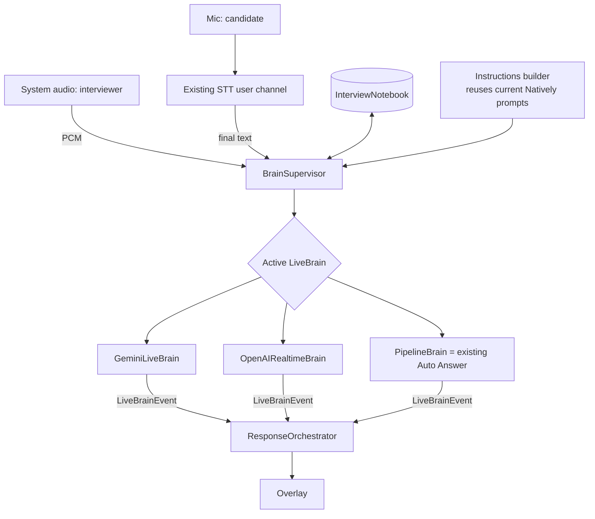

# Live Brain — Architecture Specification

> **Status:** Approved design. Canonical. Branch: `feat/live-brain`.
> **Audience:** every agent (Claude, Codex) and human working on this feature.
> **Rule:** if code and this document disagree, stop and update the document first (with the user's agreement). Do not silently diverge.
> Companion documents: [IMPLEMENTATION_PLAN.md](IMPLEMENTATION_PLAN.md) (what to build, in order) · [PROGRESS.md](PROGRESS.md) (what is done).
> Background research (not normative): `docs/live-conversation-research.md`.

---

## 1. Product goal

Natively should behave like **ChatGPT Voice in a live interview, except it writes instead of speaking.**

It listens to the interviewer continuously, understands like a strong conversational model, waits until a question is really finished, asks one short clarifying question when something important is missing, remembers the whole interview, and **replaces its answer immediately when the interviewer corrects or interrupts**. The candidate (the user) reads the text and says it aloud.

### Decisions already made by the user (do not re-open without asking)

| # | Decision |
|---|---|
| D1 | Personal use, not commercial. |
| D2 | Main realtime brain: **Google Gemini Live (free tier)**. Paid APIs are acceptable. |
| D3 | Answers follow the **current Natively instructions and response style** — reuse existing prompts/contracts; do not invent a new answer style. |
| D4 | **Clarifying questions are required** (one short question, only when it materially changes the answer). |
| D5 | Privacy is not a concern for this user (audio may be sent to Google/OpenAI). Still show a one-line notice in settings. |
| D6 | **Natively never plays or produces audio.** Text is the only assistant output. |
| D7 | Backup: OpenAI Realtime (optional, paid key) → today's Natively pipeline (always available). |
| D8 | Keep it simple. Reuse existing infrastructure. No new services, servers, databases, WebRTC, or native modules. |
| D9 | Everything is behind one setting, **off by default**. With it off, Natively behaves exactly as before. |
| D10 | **SUPERSEDED by D12.** ~~Fast text path (2026-11-25, after the Phase 0 spike).~~ Gemini Live listens, detects turns, handles interruptions and decides *what to do*; the **answer text is written by a fast text model** through Natively's existing answer path, so the whole answer appears in seconds instead of at speaking pace. See §4.1 and §4.4. |
| D11 | **SUPERSEDED by D12.** ~~Accept the decide_turn tool call (2026-11-26, after the Phase 4 spike).~~ The tool call arrives 1.3–1.9 s after speech end, slower than the 1.5 s gate. The user accepted it: about 1 s doesn't matter much, and Gemini's merged question handles corrections. The transcription-marker fallback (§4.1) is deferred to Phase 7 tuning. |
| D12 | **Gemini Live writes the answer itself, streamed in real time (2026-11-26, user decision after the first live tests).** The goal is ChatGPT Voice behaviour: the realtime model listens and answers like a human. Gemini Live answers by itself (no `decide_turn`, no separate text model). Natively discards Gemini's audio (D6 unchanged) and streams **Gemini's output transcription into the overlay word by word as Gemini speaks** — it never waits for the complete answer. First words are expected ~0.5–1 s after the interviewer stops; the full answer arrives at speaking pace (accepted, like ChatGPT Voice). Interruptions use Gemini's own barge-in. Answer style and profile/resume/JD/mode context go into Gemini's session instructions (§5). The AnswerWriter (§4.4) is not used by GeminiLiveBrain. Measured reason D10 was chosen and is now overridden: Phase 0 found `TEXT` output rejected and transcription at speaking pace (~25 s for 65 words). |

| D13 | **ElevenLabs Realtime as a third provider (2026-11-26, user decision).** Live Brain offers **Gemini Live · OpenAI Realtime · ElevenLabs Realtime** (plus the existing pipeline), all working the same way under D12: the realtime model listens and writes the answer itself, streamed into the overlay as it arrives. The user enters an ElevenLabs API key in the Live Brain card like the other two. OpenAIRealtimeBrain and ElevenLabsRealtimeBrain share one protocol client (§4.2, §4.5). The user accepted audio mode with its streamed transcript and discarded audio after the Phase 6 spike. Models: `eleven_realtime_v1_mini` (default) and `eleven_realtime_v1_max` (labelled “slower (~3 s)”). |
| D14 | **Chat-style question → answer (2026-11-26, user decision).** In the overlay, each interviewer question is shown as an interviewer bubble directly above its Live Brain answer, like ChatGPT. The bubble text comes from the realtime provider's own input transcript: it streams while the interviewer speaks on Gemini, and arrives as one block after speech end on OpenAI (Whisper). When the provider gives no transcript for a turn, the existing STT final (Groq today) fills the bubble. Uses the existing `role: 'interviewer'` overlay row; the rolling transcript strip at the top is unchanged. Filler turns get a bubble with no answer. **Outdated rule (changes §7 replace-in-place for realtime text answers):** every answer stays visible, like a chat. A new answer marks the previous one outdated only when the interviewer cut it off while its text was still streaming (text grew within the last 1.5 s when the interviewer spoke or the provider cancelled). A later correction ("Actually, use MongoDB") appears as a new question and answer below. The pipeline/AnswerWriter paths keep the old 20 s rule. Supersedes the earlier "skip it" on showing the Gemini transcript in chat, and extends the §7 "same overlay UI as Auto Answer" rule with this one row. |
| D15 | **Filler turns never get an answer (2026-11-26, user decision).** Both layers: (1) every realtime provider's instructions end with a mandatory filler rule (filler-only turn -> exactly `No action.`; never repeat, continue or rephrase the previous answer after being interrupted by filler); (2) a local safety net in ResponseOrchestrator: when the interviewer bubble of a turn is only filler words (mm-hmm, uh-huh, okay, right, yeah, sure, got it, thank you...), that turn's answer is not shown, and the previous answer stays current. Exception: while an `Ask:` is waiting, a short reply such as "Yes." is answered. Reverses the earlier ElevenLabs condition "no local filtering". |

### Non-goals

- Text-to-speech, audio playback, voice output of any kind.
- Replacing audio capture, STT providers, or the existing Auto Answer engine.
- GPT-Live (text-only output is not documented by OpenAI — revisit only if that changes).
- Self-hosted audio models, Pipecat/LiveKit, Smart Turn, WebRTC.
- Redesigning the overlay UI beyond the small additions in §7.

---

## 2. Big picture

```
 Interviewer audio (system/speakers)            Candidate audio (mic)
          │   existing native capture — UNCHANGED (macOS SCK/CoreAudio, Windows WASAPI)
          ▼                                              ▼
 ┌──────────────────────────┐                  existing STT (mic channel)
 │ LiveBrain (selected)     │◄── "Candidate said: …" (text item)
 │  • GeminiLiveBrain       │
 │  • OpenAIRealtimeBrain   │◄── Instructions = current Natively answer prompt
 │  • PipelineBrain         │      + clarification rule + profile/resume/JD/mode
 └────────────┬─────────────┘◄──► InterviewNotebook (full-context memory)
              │ LiveBrainEvent stream
              ▼
      ResponseOrchestrator ──► existing overlay delivery (what-to-answer:*, token batches)
              │                    answer · 💬 ask · outdated/replaced · status
              ▼
      BrainSupervisor: health, ~14-min session rollover, fallback chain
```



---

## 3. Components

All new code lives in **`premium/electron/liveBrain/`** (main process, shared across macOS and Windows). No platform-specific code is introduced.

| Component | File | New / Reuse | Responsibility |
|---|---|---|---|
| Types & contracts | `types.ts` | New | `LiveBrain` interface, `LiveBrainEvent`, `NotebookSnapshot`, config types |
| Instructions builder | `instructions.ts` | New (thin) | Builds the session instruction text **from existing Natively prompts** (§5) |
| Response parser | `responseParser.ts` | New | Turns streamed text into `wait` / `ask` / `answer` (§6) |
| InterviewNotebook | `InterviewNotebook.ts` | New | Durable interview memory + summary; seeds new sessions (§8) |
| GeminiLiveBrain | `brains/GeminiLiveBrain.ts` | New | Gemini Live WebSocket session (§4.1) |
| OpenAIRealtimeBrain | `brains/OpenAIRealtimeBrain.ts` | New, reuses socket/backoff/quota/resample logic from `electron/audio/OpenAIStreamingSTT.ts` | OpenAI Realtime text-only session (§4.2) |
| PipelineBrain | `brains/PipelineBrain.ts` | New adapter over existing code | Wraps today's Auto Answer → `IntelligenceEngine` path as a `LiveBrain` (§4.3) |
| ResponseOrchestrator | `ResponseOrchestrator.ts` | New | Owns what the overlay shows; replace-in-place; stale marking; generation ids (§7) |
| BrainSupervisor | `BrainSupervisor.ts` | New | Picks brain, health checks, rollover, fallback chain (§9) |
| Factory | `index.ts` | New | Exhaustive provider switch; wiring into `main.ts` |
| Audio capture | `native-module/*`, `electron/audio/*Capture.ts` | **Reuse, unchanged** | |
| STT (mic; interviewer for PipelineBrain) | `electron/audio/*STT.ts`, `createSTTProvider` in `electron/main.ts` | **Reuse, unchanged** | |
| Auto Answer engine | `premium/electron/autoAnswer/SimpleAutoAnswer.ts` | Reuse (+ Phase 1 correction fix) | |
| Answer prompts | `electron/llm/prompts.ts`, `electron/llm/WhatToAnswerLLM.ts` | **Reuse** | Source of the response style |
| Summarizer | `electron/llm/ConversationSummarizer.ts` | Reuse | Notebook summaries |
| Overlay | `src/components/NativelyInterface.tsx` + `src/lib/overlay*.mjs` | Reuse + small additions | |

### Factory rule (from CLAUDE.md)

Provider selection uses an exhaustive switch. An unknown provider throws; it is never silently routed to another provider.

```ts
switch (config.brain) {
  case 'gemini-live':     return new GeminiLiveBrain(deps);
  case 'openai-realtime': return new OpenAIRealtimeBrain(deps);
  case 'elevenlabs-realtime': return new ElevenLabsRealtimeBrain(deps);
  case 'pipeline':        return new PipelineBrain(deps);
  default: { const never: never = config.brain; throw new Error(`Unsupported live brain: ${never}`); }
}
```

---

## 4. The LiveBrain contract

```ts
// premium/electron/liveBrain/types.ts  (normative shape; names may be refined in Phase 2,
// but any change must be reflected here)

export type LiveBrainId = 'gemini-live' | 'openai-realtime' | 'elevenlabs-realtime' | 'pipeline';

export interface LiveBrainStartContext {
  sessionId: string;              // one per meeting; reset on new meeting
  responseNamespace?: string;     // unique per brain instance within the meeting
  instructions: string;           // from instructions.ts (§5)
  notebook: NotebookSnapshot;     // empty at meeting start; filled on rollover/fallback
  recentTurns: ConversationTurn[];// last ~3–5 min verbatim, for rollover/fallback seeding
  signal: AbortSignal;
}

export interface ConversationTurn {
  role: 'interviewer' | 'candidate' | 'assistant';
  text: string;
  at: number;                     // epoch ms
}

export type LiveBrainEvent =
  | { type: 'status'; status: 'connecting' | 'ready' | 'degraded' | 'closed'; detail?: string }
  | { type: 'interviewer_speech_started'; at: number }       // interruption signal
  | { type: 'interviewer_speech_stopped'; at: number }
  | { type: 'interviewer_transcript'; text: string; final: boolean; at: number } // display only
  | { type: 'response_started'; responseId: string; at: number }
  | { type: 'response_delta'; responseId: string; text: string }
  | { type: 'response_done'; responseId: string; status: 'completed' | 'cancelled' | 'failed'; finalText?: string }
  | { type: 'response_silent' }
  | { type: 'session_expiring'; inMs: number; resumable?: false } // provider goAway / time limit
  | { type: 'error'; code: LiveBrainErrorCode; fatal: boolean; detail?: string };

export type LiveBrainErrorCode =
  | 'auth' | 'quota' | 'rate_limited' | 'network' | 'protocol' | 'timeout' | 'unsupported';

export interface LiveBrain {
  readonly id: LiveBrainId;
  start(ctx: LiveBrainStartContext): Promise<void>;
  /** 16-bit mono PCM from the interviewer channel. Brain resamples as its provider requires. */
  pushInterviewerAudio(pcm: Int16Array, sampleRate: number): void;
  /** Final candidate (mic) utterance, added as labelled context — never as interviewer audio. */
  addCandidateText(text: string, at: number): void;
  requestClarificationAnswer?(): void;
  requestSessionRollover?(inMs: number): boolean; // true when the provider owns resumption
  addHistoryContext?(history: string): void;       // append context without asking for an answer
  /** Ask the provider to stop the in-flight response (if any). Idempotent. */
  cancelResponse(reason: string): void;
  stop(): Promise<void>;
  onEvent(listener: (e: LiveBrainEvent) => void): () => void;
}
```

**Invariants**

1. A brain never emits audio to any output device.
2. Interviewer audio and candidate text are never mixed: the provider's "user" voice is always the interviewer.
3. `response_delta` events for a `responseId` stop after that response's `response_done`.
4. `stop()` releases sockets/timers and is safe to call twice.
5. A brain does not decide what the overlay shows — it only emits events (§7).

### 4.1 GeminiLiveBrain (default)

Transport: WebSocket to the Gemini Live API (`BidiGenerateContent`). Key from the user's Google AI Studio key in Natively settings. **All protocol details below must be verified in Phase 0 against current Google docs before implementation; record findings in PROGRESS.md.**

**Role (D12, current):** Gemini Live is the **listener and the answer writer**, like ChatGPT Voice.

- **Setup message:** model (setting), `responseModalities: ["AUDIO"]` (the only accepted value), `systemInstruction` = **answer instructions** (§5: existing Natively answer prompt + live preamble + spoken-sentinel protocol + clarification/correction rules + profile/resume/JD/mode context), automatic activity detection enabled, `inputAudioTranscription` enabled (interviewer text for display), **`outputAudioTranscription` enabled (the answer text)**, session resumption enabled, context window compression enabled. **No tools.**
- **Answer streaming:** the first output-transcription chunk of a model turn → `response_started`; every chunk → `response_delta` immediately (no buffering beyond the sentinel check in §6); `turnComplete` → `response_done{completed}`. The overlay shows the text as Gemini speaks it.
- **Audio output is always discarded.** Natively never plays it (D6).
- **Nothing to answer / clarification:** handled by the spoken sentinels in §6, read from the transcription (`responseParser`). If the model emits no transcription for a turn, nothing is shown.
- **Interruption (barge-in):** Gemini's `interrupted` → `response_done{cancelled}` for the in-flight response and `interviewer_speech_started`; Gemini's next turn is the replacement answer (ResponseOrchestrator replace-in-place, §7).
- **Candidate text:** unchanged (client content `Candidate said: …`, `turnComplete:false`).
- Session limit, `goAway`, rollover, errors: unchanged (below).
- **Must be verified first (spike):** that the selected model emits `outputAudioTranscription` incrementally (word/phrase chunks, not one block at the end), time to first chunk after speech end, and how reliably it follows the spoken sentinels. Record in PROGRESS.md.

**Former role (D10, superseded — kept for history):** Gemini Live is the **listener and decider**, not the answer writer. Measured in Phase 0: `gemini-3.8-live` rejects `TEXT` output, and its transcribed output arrives at speaking pace (~25 s for 65 words) even though the first words come ~0.5 s after the interviewer stops. So Gemini decides fast, and the answer text comes from the AnswerWriter (§4.4).

- **Setup message:** model (setting; default `gemini-3.8-live`), `responseModalities: ["AUDIO"]` (the only accepted value), `systemInstruction` = **decider instructions** (§5), automatic activity detection enabled, `inputAudioTranscription` enabled (interviewer text for display and for the AnswerWriter), session resumption enabled, context window compression enabled, and **one function tool `decide_turn`**.
- **Decision via tool call (primary):**
  ```
  decide_turn({
    action: "answer" | "ask" | "wait",
    question: string,        // the interviewer's question as understood, self-contained,
                             //   with corrections/follow-up context folded in (answer or ask)
    clarification?: string,  // one short question for the candidate to ask (ask only)
    kind?: "new" | "follow_up" | "correction"
  })
  ```
  The instructions tell Gemini to call `decide_turn` at every end of interviewer turn and **not to speak an answer**. A tool call arrives as JSON (`toolCall`), not paced by speech. Natively replies with a minimal `toolResponse` (`{ok:true}`) so the session continues. **Phase 4 must measure tool-call latency first** (spike extension); if tool calls are too slow or unreliable on this model, use the fallback below.
- **Fallback decision via transcription marker:** Gemini speaks only a one-word marker (`answer` / `wait` / `ask: <question>`); `outputAudioTranscription` turns it into text within ~1 s; the question text then comes from `inputAudioTranscription` + Natively's transcript.
- **Audio output is always discarded.** Natively never plays it (D6).
- **Events emitted:** `decision` (new `LiveBrainEvent`, see below) instead of answer `response_delta`s. `interviewer_transcript` from input transcription.
- **Input audio:** PCM 16-bit mono at the rate Google requires (expected 16 kHz — verify). Sent in ~20–100 ms chunks.
- **Candidate text:** sent as a client content turn labelled `Candidate said: …` **without** triggering a response.
- **Interruption:** provider's `interrupted` signal → emit `interviewer_speech_started` (if not already) and `response_done{status:'cancelled'}` for the in-flight response.
- **Session limit:** ~15 min for audio sessions (verify). Provider `goAway` → `session_expiring`. Supervisor rolls over proactively at ~13–14 min (§9).
- **Free-tier limits / 429** → `error{code:'rate_limited'|'quota'}`; supervisor falls back.

### 4.2 OpenAIRealtimeBrain (optional, paid)

- WebSocket `wss://api.openai.com/v1/realtime` (conversation session, **not** `intent=transcription`).
- `session.update`: `type:"realtime"`, `output_modalities:["text"]`, input `audio/pcm` 24 kHz, `turn_detection: { type:"semantic_vad", eagerness:"low", create_response:true, interrupt_response:true }`, `instructions` (§5).
- Candidate text → `conversation.item.create` (user role, prefixed `Candidate said:`), no `response.create`.
- Events: `input_audio_buffer.speech_started/stopped`, `response.created`, `response.output_text.delta`, `response.done` (status `cancelled` on interruption).
- Reuse from `electron/audio/OpenAIStreamingSTT.ts`: WebSocket setup, auth header, 24 kHz resampling and 100 ms batching, exponential backoff, keepalive, terminal-quota classification (401/403/`insufficient_quota`). Extract shared helpers **without changing STT behaviour**.
- 60-minute session limit (documented) → rollover at ~50 min.
- Model name is a setting (OpenAI naming is inconsistent; verify in Phase 0).

### 4.5 ElevenLabsRealtimeBrain (optional, paid, D13)

- **Shares the OpenAI Realtime protocol client with §4.2.** One module implements the OpenAI-Realtime-compatible session (connect, `session.update`, audio append, events, cancel, backoff, error classification); `OpenAIRealtimeBrain` and `ElevenLabsRealtimeBrain` are thin configurations of it (endpoint URL, auth header, model, audio rate). No copy-pasted protocol code.
- Desktop connects to `wss://api.elevenlabs.io/v1/convai/realtime` with `xi-api-key` and sends `session.update` on socket open. The update selects the model and `output_modalities:["audio"]`, with mono PCM16 input at 24 kHz, semantic VAD, and PCM output using voice `brian`. Ready follows `session.updated`. The default session limit is 600 seconds. Schedule notebook-seeded rollover at 8.5 minutes.
- The Phase 6 spike found that both models accepted the text-only configuration and timed out without an answer from interviewer PCM. Forward every `response.output_audio_transcript.delta` as it arrives and discard the underlying audio (D6). Audio-mode transcript events arrived in bursts. Drop any deltas for the interrupted response as soon as cancellation starts.
- Reuse the answer instructions and spoken sentinel parser (§5, §6), overlay (§7), candidate context, and error handling (§4.2). ElevenLabs adds a stronger instruction for `No action.` and `Ask:`. Mini returned `No action.` in one follow-up filler check, after both models answered filler in the initial spike. Mini still omitted `Ask:` for the ambiguous prompt in the follow-up. Sentinel compliance varies by turn. [Spike and follow-up results](PROGRESS.md#phase-6-step-0--elevenlabs-realtime-spike-2026-11-26)

### 4.3 PipelineBrain (always-available fallback)

Adapter around today's path: interviewer STT → `SimpleAutoAnswerEngine` → `IntelligenceEngine.runAutoAnswer` → `runWhatShouldISay` streaming. It maps existing token/discard/answer events to `LiveBrainEvent`s. It ignores `pushInterviewerAudio` (interviewer audio already reaches STT through existing wiring). It must include the Phase 1 correction fix.

### 4.4 AnswerWriter (fast text path, D10)

> **Not used by GeminiLiveBrain since D12.** Kept only if another brain needs it; the clarification timeout (§7 rule 6) is the one remaining caller candidate — under D12 it sends the assumption instruction to Gemini as a client text turn instead.

File: `premium/electron/liveBrain/AnswerWriter.ts` — a thin adapter, **not** a new answer engine.

- Triggered by a `decision` with `action:"answer"`. Calls Natively's **existing** answer path (`IntelligenceEngine.runAutoAnswer` / `runWhatShouldISay`, automatic mode) with `question` from the decision, so the answer uses the **current Natively prompts, style, profile/resume/JD/mode context, RAG, length rules and streaming** unchanged (D3). The user's **selected answer model and key** (AI Providers) write it.
- Adds the InterviewNotebook (§8) as extra context for that call (constraints, decisions, clarifications), so the text model knows what Gemini knows.
- Streams through the existing token path; the ResponseOrchestrator (§7) shows it exactly like an Auto Answer answer.
- Cancellation: a new `decision` (or `interviewer_speech_started` followed by an `answer` decision) cancels the in-flight answer via the existing `cancelAutomaticAnswer` and starts the new one — replace-in-place per §7.
- `action:"ask"` does **not** call the text model: the clarification is shown directly.
- `action:"wait"` does nothing.
- The old Auto Answer judge is **not** used while GeminiLiveBrain is active (Gemini is the judge); only its answer-generation stage is reused.

**OpenAIRealtimeBrain** may keep writing the answer itself (it supports text-only output at full speed); it can switch to the same AnswerWriter later if style consistency requires it.

---

## 5. Instructions (response style = current Natively)

**Under D12, GeminiLiveBrain uses the full single-model instruction set below** (`buildAnswerInstructions`, variant full | trimmed), with one change: the output protocol is the **spoken** sentinel form in §6, because Gemini's text is a transcription of speech. Keep it spoken-answer friendly (the existing `HUMAN_SPOKEN_ANSWER_CONTRACT` already is). The decider instructions are no longer used.

**Former (D10, superseded): two instruction sets:**

- **Decider instructions** (Gemini Live session, sent once): live-session preamble, `decide_turn` protocol, clarification rule, correction rule, profile summary, notebook on rollover. Short; no answer-style rules (Gemini doesn't write the answer).
- **Answer instructions** (AnswerWriter): **unchanged existing Natively answer prompts** — nothing new to write; D3 is met by reuse.

The list below describes the full single-model instruction set, still used by OpenAIRealtimeBrain when it writes answers itself:

`instructions.ts` builds one text, sent **once per session** (system instruction), never per answer:

1. **The current Natively answer prompt** used for spoken interview answers today — resolved through the same code path `WhatToAnswerLLM` uses (`UNIVERSAL_WHAT_TO_ANSWER_PROMPT`, which embeds `HUMAN_SPOKEN_ANSWER_CONTRACT` and `SPOKEN_ANSWER_CONTRACT`, plus mode prompt e.g. `MODE_TECHNICAL_INTERVIEW_PROMPT`). **Do not copy-paste prompt text into new files — import/compose it.**
2. **Live-session preamble** (new, short): you are listening to a live interview; the audio you hear is the interviewer; lines starting `Candidate said:` are the candidate; write what the candidate should say next; text only.
3. **Output protocol** (new, short — §6).
4. **Clarification rule** (new, short): ask only if missing information materially changes the answer; one short question; never ask what was already answered; never repeat a clarification; if the interviewer moves on, answer with a stated assumption.
5. **Correction rule** (new, one line): the newest interviewer instruction overrides earlier requirements.
6. **Profile context** (existing): resume/profile, job description, custom context, interview mode — the same sources the current answer path uses.
7. **Notebook** (on rollover/fallback only): `NotebookSnapshot` rendered as text (§8).

Phase 0 compares the full current prompt vs a trimmed variant (same style rules, scenario-specific rules removed) on the test corpus; the winner is recorded in PROGRESS.md and becomes the default. Both variants are composed from existing prompt constants.

---

## 6. Output protocol (provider-independent)

**Under D12, GeminiLiveBrain writes answer text itself, so it uses this protocol through its output transcription.** Because the text is transcribed speech, sentinels must be **speakable words**, not bracket tokens: the model says nothing at all (preferred) or exactly `No action.` for filler/small talk/unfinished questions, and starts with `Ask:` for a clarification. `responseParser` maps `No action` → `[[NO_ACTION]]` and a leading `Ask:` → `[[ASK]]`, case-insensitively, tolerating punctuation; the bracket forms stay accepted for text-writing brains. The exact wording is confirmed in the D12 spike.

**Former (D10):** GeminiLiveBrain used the `decide_turn` tool call (§4.1), mapped to the same three outcomes below (`wait` → `[[NO_ACTION]]`, `ask` → `[[ASK]]`, `answer` → AnswerWriter). The sentinel text protocol below applies to brains that write answer text themselves (OpenAIRealtimeBrain) and to the Gemini transcription-marker fallback.

Add to `LiveBrainEvent` (§4):

```ts
| { type: 'decision'; decisionId: string; action: 'answer' | 'ask' | 'wait';
    question?: string; clarification?: string; kind?: 'new' | 'follow_up' | 'correction'; at: number }
```

Plain text with two sentinels. No JSON — this keeps the existing Natively response style and works with every provider, including transcription-based Gemini output.

| Model output begins with | Meaning | Overlay |
|---|---|---|
| `[[NO_ACTION]]` | Nothing to answer (small talk, filler, interviewer not done) | Nothing shown; previous answer stays current |
| `[[ASK]]` + question | Clarification needed | 💬 Ask tip with the question |
| anything else | Answer | Stream as an answer in current Natively style |

- `[[NO_ACTION]]` reuses the sentinel already used by `electron/llm/promptSystemV2.ts`.
- `responseParser.ts` decides the kind from the first ~16 characters of a response, buffering only until it can decide (must not add perceptible delay), then streams the remainder. It strips sentinels and tolerates whitespace/markdown around them. If no sentinel arrives, it is an answer.
- If the provider emits a sentinel mid-text, treat as plain text (no mid-stream kind switch).

---

## 7. ResponseOrchestrator (what the screen shows)

Single owner of overlay state for Live Brain. Brains never write to the overlay directly.

**States per answer slot:** `streaming` → `complete` | `outdated` | `cancelled`.

Rules:

1. **Generation ids.** Every displayed answer has a `generation` number. Deltas for an older generation are dropped. (Mirror the existing generation guard in `src/lib/overlayIntelligenceGeneration.mjs`.)
2. **Interruption.** On `interviewer_speech_started` while an answer is `streaming` or completed within the last ~20 s: show a light marker "⏸ interviewer speaking" on that answer. Do not delete it.
3. **Replacement.** When the next response is an **answer** or **ask**, the previous answer becomes `outdated` (folded, still viewable) and the new one becomes current.
4. **Filler.** If the next response is `[[NO_ACTION]]`, remove the marker and keep the previous answer current.
5. **Never show speculation.** Only text from a provider response that has started (`response_started`) is displayed.
6. **Clarification timeout.** For realtime brains (D12), every completed `Ask:` starts a 10-second timer. If no new interviewer speech arrives, call `requestClarificationAnswer` so the same brain states a reasonable assumption and answers using the question it heard. This path needs no interviewer transcript. For PipelineBrain, the timer requires the original question text. If it is available and no new interviewer speech arrives within 10 seconds, pass the question to the AnswerWriter with "The interviewer did not clarify; state a reasonable assumption first, then answer." Otherwise, show the clarification without an assumption timer.
7. **Delivery.** Reuse the existing overlay delivery channels (`intelligence-token-batch`, `what-to-answer:*` handshake/replay). New message kinds are added to the existing `Message` model, not a new renderer.

Overlay message kinds: `answer`, `ask`, plus flags `outdated`, `interviewerSpeaking`. Status line: `Listening · Thinking · Answer ready · Reconnecting · Backup brain`.

### UI rule: identical to Auto Answer (user decision)

Live Brain answers **look and behave exactly like Auto Answer answers** in the overlay. No new visual design.

- Render through the **same message path and components** Auto Answer uses today (`NativelyInterface.tsx` `Message` with `automaticAnswer` / `whatToAnswerGeneration`, the same streaming, pending, failed and generation-guard handling, the same overlay delivery/replay `what-to-answer:*`). A Live Brain answer is an automatic answer row like any other.
- Same typography, spacing, colours, bold key terms, markdown/code rendering, copy/scroll behaviour, and answer header as Auto Answer.
- The only additions, kept minimal and built from existing styles/tokens (no new colours or components):
  - **Clarifying question:** shown in the same answer row style, prefixed with the label **"Ask:"**.
  - **Outdated answer:** the previous answer row stays but is dimmed/collapsed using existing muted styles, with a small "Updated" label on the new row.
  - **Interviewer speaking:** a small text marker using the existing status/pending style.
- If an addition cannot be expressed with existing styles, ask the user before introducing anything new.

---

## 8. InterviewNotebook (full context)

Natively-owned memory so context survives the ~15-min Gemini limit, provider switches and failures.

```ts
export interface NotebookSnapshot {
  topics: string[];                 // ordered topics covered
  currentTopic: string | null;
  requirements: string[];           // stated by interviewer for current topic
  constraints: string[];            // incl. corrections ("no caching"), newest wins
  clarifications: { asked: string; answer: string | null }[];
  decisions: string[];              // what the candidate committed to
  answered: string[];               // short labels of questions already answered
  summary: string;                  // compressed earlier conversation
  updatedAt: number;
}
```

- **Source of truth for the transcript** remains `electron/SessionTracker.ts` (unchanged).
- Updated **in the background** after each completed answer and on corrections, using the user's fast/free model through existing `LLMHelper` (and `ConversationSummarizer` for `summary`). Never on the answer's critical path.
- Rendered into session instructions on rollover/fallback, together with the last ~3–5 min of turns verbatim.
- Cleared on meeting start/end. Never shared across meetings.
- Bounded: rendered notebook ≤ ~1,500 tokens; summary is re-compressed when exceeded.

---

## 9. BrainSupervisor (reliability)

- **Selection:** the Live Brain provider setting (§9b), with Gemini Live as default.
- **Fallback chain:** follow §9b and skip realtime providers without a usable key. Fallback triggers: fatal error, `auth`/`quota`, exhausted `rate_limited` backoff, no `response_started` within ~6 s of `interviewer_speech_stopped` twice in a row, socket closed and reconnect failed.
- **Rollover:** at ~13–14 min (Gemini), ~50 min (OpenAI), or 8.5 min (ElevenLabs), or on `session_expiring`. Open the new session in parallel, seed with instructions + notebook + recent turns, switch when `ready`, prefer switching while no response is streaming, then stop the old session. Use provider session resumption when available.
- **Gemini resumption:** with a resume handle, Gemini's transport owns `goAway`. It rolls immediately when idle or when the deadline is missing or under 1.5 s. During an answer it waits for `turnComplete` or `interrupted`, up to one second before the deadline. The supervisor prepares a notebook-seeded session when no handle is available and retries with a seeded session if resumption fails.
- **Recovery:** Phase 5 retries the preferred brain at the next meeting. A mid-meeting retry may be added at a natural boundary.
- **Audio continuity:** while switching, buffer interviewer audio (≤ 10 s) and replay into the new session.
- **Meeting lifecycle:** start with meeting start, stop on meeting end via the same path that ends Auto Answer today (`auto_disabled_or_meeting_ended`).

---

## 9a. Settings & activation (how the user turns it on)

### Where the switch lives

**Settings → General**, as a new row **directly below the existing "Auto Answer" row**, built the same way as that row:

- File: `src/components/SettingsOverlay.tsx`, inside the `activeTab === 'general'` block, immediately after the Auto Answer row (the `{autoAnswerAvailable && (...)}` block that renders `<SettingsToggle label={t('Auto Answer')} …/>`).
- Same layout: icon tile · title **"Live Brain"** · `LiquidGlassBadge variant="sky"` **"Beta"** · one-line description · `SettingsToggle` on the right.
- Description: *"Listens to the interviewer in real time and writes answers like a live conversation"*.
- The General row has only the on/off switch. Provider, model and API keys live in **Settings → Audio → "Live Brain Provider"** (§9b).

### Behaviour

| Live Brain switch | What runs during a meeting |
|---|---|
| **Off (default)** | Existing Natively exactly as today — Auto Answer (if its own switch is on), manual answers, Direct Assist, everything unchanged. |
| **On** | Live Brain owns automatic answering for the meeting (§9). The existing Auto Answer engine's **automatic dispatch is suppressed** to avoid double answers. Manual answer buttons, Direct Assist, transcript, notes and every other feature keep working unchanged. |

**Scope rule (user decision 2026-11-26): Live Brain answers only what the interviewer says out loud.** Everything typed or triggered by hand keeps the default Natively behaviour, unchanged, even while Live Brain is on:

| Input | Handled by |
|---|---|
| Interviewer **speech** (system audio) → automatic answer, clarification, interruption/correction | **Live Brain** |
| Typed questions / chat in the overlay | Default Natively |
| Direct Assist (typed or screenshot) | Default Natively |
| Manual "What to answer" hotkey/button press | Default Natively (and it cancels an in-flight Live Brain answer the same way a manual press cancels an Auto Answer today) |
| Screenshots, screen/DOM context requests | Default Natively |
| Recap, follow-up questions, notes, coding hints and other modes | Default Natively |

Live Brain never intercepts text input. The candidate's own mic speech is context for Live Brain (`Candidate said: …`), never a trigger.

Rules:

1. **Independent of the Auto Answer switch.** Live Brain does its own automatic answering; the user does not need Auto Answer on. When Live Brain is turned off, Auto Answer's own switch decides again, exactly as before.
2. **Fallback uses the existing engine.** When Live Brain falls back to `PipelineBrain` (§9), it runs the existing Auto Answer path for the rest of the meeting even if the Auto Answer switch is off (the user asked for live answering). If the existing engine is unavailable in this build (`autoAnswerAvailable === false`), fallback shows a status message instead of answering.
3. **Takes effect immediately.** Turning it on during a meeting starts the BrainSupervisor; turning it off stops it cleanly (cancel in-flight response, close session) and hands automatic answering back to the existing behaviour. No restart required.
4. **Keys.** Configured in Settings → Audio → Live Brain Provider (§9b). **Never hardcoded.** If the selected provider has no usable key, turning the switch on shows a short inline message ("Add a Gemini key in Audio → Live Brain Provider") and the switch stays off.
5. **Not gated by Pro/sharing.** Live Brain is the user's own feature (personal use, D1); it does not reuse `autoAnswerAccess` gating.
6. **Persisted** like Auto Answer, in the existing settings store, and survives restart.

### Wiring (mirror the Auto Answer switch exactly)

| Layer | Auto Answer today (reference) | Live Brain (new, same pattern) |
|---|---|---|
| Setting key | `SettingsManager` (`autoAnswerEnabled`) via `appState.getAutoAnswerEnabled()/setAutoAnswerEnabled()` | `liveBrainEnabled` via `appState.getLiveBrainEnabled()/setLiveBrainEnabled()` |
| IPC (main) | `safeHandle('get-auto-answer-enabled')`, `safeHandle('set-auto-answer-enabled')` in `electron/ipcHandlers.ts` (~8446, ~8508) | `safeHandle('live-brain:get-enabled')`, `safeHandle('live-brain:set-enabled')` — returns `{ success, error?, message? }` like Auto Answer |
| Preload | `getAutoAnswerEnabled`, `setAutoAnswerEnabled` in `electron/preload.ts` (~1319, ~3667) | `getLiveBrainEnabled`, `setLiveBrainEnabled` (+ types in the same interface) |
| Renderer state | `autoAnswerEnabled` + optimistic update + rollback on failure (`SettingsOverlay.tsx` ~2804–2833) | `liveBrainEnabled` with the same optimistic update / rollback pattern |
| Runtime | Auto Answer engine checks enabled state | `BrainSupervisor` starts/stops on change; Auto Answer dispatch checks `!liveBrainActive` |

Validation of the `set` payload in main: boolean only; reject anything else.

---

## 9b. Live Brain Provider settings (API keys) — Settings → Audio

**API keys are never hardcoded** in source, config files, tests, scripts or docs. They are entered by the user in the app and stored only in the existing secure credential store.

### Where

**Settings → Audio**, a new **"Live Brain Provider"** section placed after the existing **Speech Provider** section, built with the **same UI pattern as Speech Provider** (provider selector + per-provider key field + test/status), reusing the same components and styles.

### What it contains

| Field | Values | Notes |
|---|---|---|
| Provider | **Gemini Live** (default) · **OpenAI Realtime** · **ElevenLabs Realtime** (D13) · **Existing pipeline (no extra key)** | Maps to `LiveBrainId` (`'elevenlabs-realtime'` added). Exhaustive list; adding a provider later = add a `LiveBrain` + a row here. |
| API key (per provider) | Google AI Studio key (Gemini Live) · OpenAI API key (OpenAI Realtime) · ElevenLabs API key (ElevenLabs Realtime) | Masked input, same as Speech Provider keys. Saved via `CredentialsManager` (`setLiveBrainElevenlabsKey`). "Use my AI Providers key" does not apply to ElevenLabs unless an existing ElevenLabs key is already stored elsewhere in Natively (check during implementation; reuse it if so). Dev builds may read `ELEVENLABS_API_KEY` from `.env`, same rules as the other env keys. |
| "Use my AI Providers key" | checkbox, default **on** when an AI Providers key for that vendor already exists | If the Live Brain key is empty and this is on, use the existing Gemini/OpenAI key from Settings → AI Providers. No duplicate typing needed. |
| Model | text/select, default chosen in Phase 0 | `liveBrainGeminiModel`, `liveBrainOpenaiModel`, `liveBrainElevenlabsModel` (default `eleven_realtime_v1_mini`; list `eleven_realtime_v1_mini`, `eleven_realtime_v1_max`) (settings store). |
| Instruction variant | Full · Trimmed | `liveBrainPromptVariant`; default decided in Phase 0/7. |
| Test connection | button | Opens a short session, reports OK / auth error / quota / unsupported model. No audio sent. |
| Status | text | Last error (auth, quota, rate limit) in plain words. |

Fallback order (§9) is automatic and needs no setting: selected provider → the other realtime providers that have a usable key, in the order Gemini Live, OpenAI Realtime, ElevenLabs Realtime (skipping the failed one) → Existing pipeline.

### Storage & wiring (mirror Speech Provider keys)

| Layer | Speech Provider today (reference) | Live Brain (new, same pattern) |
|---|---|---|
| Secret storage | `CredentialsManager.setDeepgramApiKey()` etc. (`electron/services/CredentialsManager.ts`) | `CredentialsManager.setLiveBrainGeminiKey()`, `setLiveBrainOpenaiKey()` (+ getters, has-key checks). Same encryption/fallback as existing keys. |
| IPC | `safeHandle('set-deepgram-api-key')` (`electron/ipcHandlers.ts` ~15352), `set-stt-provider` | `live-brain:set-provider`, `live-brain:set-key` (`{provider, apiKey}`), `live-brain:get-config` (never returns raw keys — only `hasKey`, masked suffix, `usingAiProvidersKey`), `live-brain:test-connection` |
| Preload | `setSttProvider`, `setDeepgramApiKey` (`electron/preload.ts`) | `setLiveBrainProvider`, `setLiveBrainKey`, `getLiveBrainConfig`, `testLiveBrainConnection` |
| Change broadcast | `credentials-changed` to all windows | Same `credentials-changed` event; BrainSupervisor re-reads config at next session start/rollover |
| Renderer | Speech Provider section in Audio tab | Live Brain Provider section in Audio tab, same components |

### Rules

1. Raw keys never cross to the renderer after saving; the renderer only sees `hasKey` and a masked hint.
2. Keys are never logged, never written to PROGRESS.md, test fixtures, spike output, or the Prompt Debugger.
3. Tests use fake keys and mock servers only.
4. Spike scripts (Phase 0) read the key from an environment variable at runtime, never from a file in the repo.
5. Clearing a key while Live Brain is running: finish the current response, then fall back per §9.

---

## 10. Integration points in existing code

| Where | What changes | Constraint |
|---|---|---|
| `electron/main.ts` — STT/auto-answer wiring (`createSTTProvider`, Auto Answer host `dispatch`/`judgeCandidate`, transcript `onSegment` handler) | When Live Brain is enabled and the active brain is not `pipeline`, route interviewer PCM + candidate finals to `BrainSupervisor`; suppress the automatic answer dispatch of the old engine to avoid double answers. | With the flag off, zero behaviour change. |
| Native capture callbacks for the interviewer channel (`SystemAudioCapture` wrapper) | Tap PCM for the brain in addition to STT. | No changes to native module or capture classes' platform code. |
| `SimpleAutoAnswer.ts` (`joinsDispatch` ~1072, `parkAutomatic` ~1604) | Phase 1 correction fix (benefits everyone). | Full `test:auto-answer` suite must pass. |
| `IntelligenceEngine.ts` | Expose events needed by `PipelineBrain`; Phase 0 timing mark. | No change to manual/Direct Assist paths. |
| `src/components/NativelyInterface.tsx` | `ask` kind, `outdated` fold, interviewer-speaking marker, status line. | Small, isolated edits. |
| Settings (store + UI) | General: "Live Brain" switch below Auto Answer (`liveBrainEnabled`, default false) — §9a. Audio: "Live Brain Provider" section after Speech Provider (provider, keys, model, prompt variant, test) — §9b. | Keys only in `CredentialsManager`; never hardcoded. |
| `electron/llm/promptDebug.ts` | Record Live Brain instructions and per-response timings when debug is enabled. | Dev-only as today. |

---

## 11. Latency budget (targets — to be measured, not promised)

| Metric | Target (Gemini Live) |
|---|---|
| Interviewer stops → first visible answer words (D12: Gemini's own output transcription) | median ≤ 1.5 s, p90 ≤ 2.5 s (user accepted 2026-11-26 after the Phase 4b spike: medians 1.46 s on 3.1 Flash Live Preview, 1.44 s on 3.8 Live, default VAD). Tune end-of-speech in Phase 4b to go lower without cutting in on mid-question pauses. |
| Answer text streaming | word by word as Gemini speaks; never held until the answer is complete |
| Interviewer stops → full answer visible | speaking pace (accepted under D12, like ChatGPT Voice) — record it, no target |
| `interviewer_speech_started` → "⏸ interviewer speaking" marker | ≤ 300 ms |
| Correction → replacement answer first text | ≤ 2.0 s after interviewer stops |
| Rollover visible gap | ≤ 1 s, and never mid-answer when avoidable |

Every response records: `speechStoppedAt`, `responseStartedAt`, `firstTextAt`, `doneAt`, brain id, prompt variant. Exposed in the Prompt Debugger.

---

## 12. Cross-platform

- All new code is shared main-process TypeScript + renderer changes. **No native code, no new native dependencies, no packaging/signing changes.**
- Audio capture already differs per OS (macOS: ScreenCaptureKit/Core Audio; Windows: WASAPI loopback) and is **not modified**.
- Resampling must use the existing JS/Rust resampler path, not OS tools.
- The user can physically test only on **Windows**. Every completion report must state macOS as `Reviewed but not executed on macOS` / `Requires physical macOS verification` unless tested.

---

## 13. Security & data

- Keys: existing Natively secure key storage only. Never log keys or full audio.
- No raw audio is written to disk by Live Brain.
- Transcripts/notebook stay in memory for the meeting and follow existing meeting-persistence behaviour.
- Logs must not contain full answer or transcript text outside the dev-only Prompt Debugger.

---

## 14. Open questions (resolve in Phase 0, record in PROGRESS.md)

1. Which Gemini Live model to use, and does it accept `TEXT` response modality? If not, confirm `outputAudioTranscription` latency.
2. Gemini input audio sample rate, chunk size, and VAD settings.
3. Gemini session limit, `goAway` timing, session resumption & context compression behaviour on the free tier.
4. Gemini free-tier rate limits relevant to a 60-minute interview.
5. OpenAI Realtime conversation model name and current price.
6. Full vs trimmed instruction variant quality.
